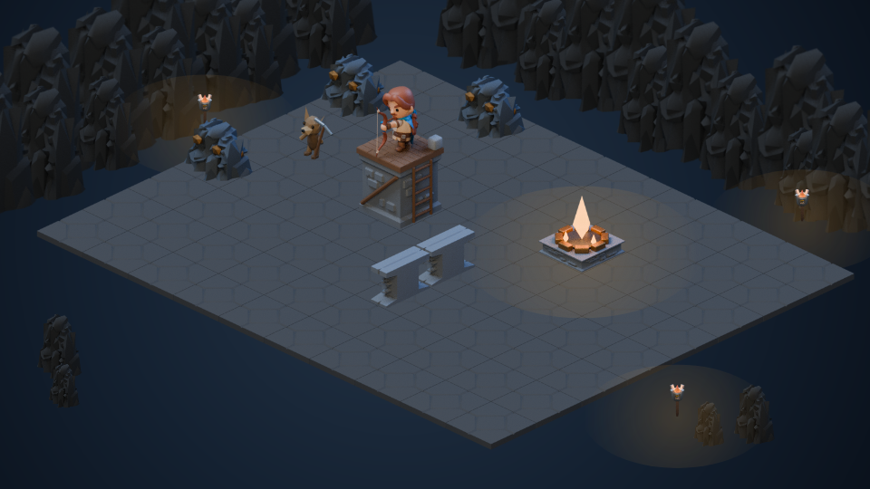

# Tower-defence-game

地下拠点を築き、資源の確保、装備の製作、研究、防衛配置を組み合わせる防衛ゲームの開発用リポジトリ。

## 現在の段階

**ゲーム全体の骨格を決めた段階です。** 2026-11-17に[全体設計](docs/OVERALL_DESIGN.md)をまとめました。wave を順にクリアして進める一人用のゲームで、襲撃はプレイヤーが開始します。

Godot 4.7系で作った wave 構造の試作が [game/](game/README.md) にあります。兵士と弓兵が攻めてくる wave を3つ用意し、設置、採掘、配下への指示、全体魔法、研究を一通り試せます。見た目は仮の立体で、アセットは未導入です。

操作できるHTML試作は、全体設計より前の旧仕様で作ったものです。実アセットを使った暗い地下拠点の外観、配置操作、画面遷移、模擬襲撃を試せますが、現行仕様の進行と経済（wave の解禁、戦闘中に湧く魔力、配下への指示、全体魔法）は未実装です。リポジトリ名は仮の管理名で、作品名は未定です。

## 基本方針

- 一人で遊ぶ。wave をクリアすると次の wave を解禁する。襲撃はプレイヤーが開始し、実時間の待ち時間で進行を止めない。
- ダンジョンコア（魔力タンク）が破壊されなければ勝利。失敗しても恒久的な損失はなく、再挑戦できる。
- スマートフォンの横画面。四角形の盤面を斜めから見る2.5D表現。
- 初期の盤面は7×7程度。周辺の岩盤を採掘すると広がる。
- 資源は魔力・資材・資金の3種類。魔力は戦闘中に地下から湧いてタンクに貯まり、資材は wave の間の採掘、資金は wave クリアの報酬で得る。
- 設備の設置は資材と資金、配下の雇用は資金、魔法研究は魔力と資金、武器研究は資金と資材で行う。
- プレイヤーが防衛施設・罠・防壁を準備中に自由配置し、防衛ルートを組み立てる。戦闘中は建設しない。
- 敵は盤面の外周から現れる。事前に分かるのは編成と方向の数だけで、固定の侵入口や予告マーカーを置かない。
- 施設は準備中の読み、配下は戦闘中に駆けつける対応、魔王の全体魔法は即時の補完を担う。
- コボルド（採掘所）、ドワーフ（工房）、エルフ射手（弓塔）、魔術師（魔法塔）は施設の一部として扱う。個別に扱うのは配下（悪魔種族）と魔王だけ。
- ダンジョンはLv1から成長し、そのLvの最後の wave をクリアするとLvが上がる。施設のレベルはダンジョンのレベルと別に扱う。
- 暗い青灰色の洞窟・石材と琥珀色の魔力を基本にし、施設と人物を判別できる明るさを保つ。
- メイン画面で採掘先の指定と配置を行い、研究画面・武器防具画面へ移動する。
- 盤面を狭める上下の帯は使わない。状況表示は上側にまとめ、操作ボタンは盤面に重ねる。
- 盤面内の施設・守備隊名は通常隠し、PCではマウスオーバー、スマホではタップした対象の名称だけを表示する。

## 設計資料

- [Godot試作の説明](game/README.md)：開き方、遊び方、仮に決めた内容、確認した範囲。
- [全体設計](docs/OVERALL_DESIGN.md)：進行、勝敗、資源、防衛手段、盤面、侵入の骨格。確定・提案・未決を区別。
- [ゲーム仕様](docs/GAME_DESIGN.md)：世界観、役割、画面。
- [決定と変更の記録](docs/DECISIONS.md)：日付ごとの決定と、廃止した旧仕様。
- [開発の進め方](docs/ROADMAP.md)：次に作る wave 構造の試作と、その完了条件。
- [旧仕様のLv1試作の記録](docs/LEVEL_ONE.md)・[模擬襲撃の記録](docs/COMBAT.md)：2026-11-16時点の試作の内容。現行仕様とは異なる。
- [アセットの採用状況と候補](docs/ASSETS.md)：取得済み素材と比較候補を区別。
- [素材の出典](art/ASSET_PROVENANCE.md)・[描画の再現手順](art/README.md)：原本、ライセンス、独自制作部分、再生成方法。
- [開発者・エージェント向け指針](AGENTS.md)：仕様を引き継ぐ際の注意点。

## 画面ラフを開く（旧仕様の試作）

以下は2026-11-16時点の旧仕様で作った試作の説明です。魔力の実時間蓄積、準備中の採掘、初期配置、費用は現行仕様と異なります。試作のコードは変更していません。

リポジトリを取得し、[prototypes/landscape-ui.html](prototypes/landscape-ui.html) をブラウザで開きます。GitHub上ではHTMLのソースが表示されるため、画面を見る場合はファイルをローカルに保存してください。

Lv1試作で確認する内容は次のとおりです。

- 施設の名前をマウスオーバーまたはタップで確認し、空白の選択で閉じる。
- 毎時6・上限70の魔力自動供給と、非表示・オフライン中の蓄積。
- 汲み上げ量と蓄積上限の研究。魔力井の選択から研究画面へ移動する。
- コボルドへの採掘指示と、作業完了による資材獲得。
- 防壁・弓塔・魔法塔・罠の仮置き、費用を消費しての配置確定、取消。
- 施設Lv1→2の強化費用と残高不足時の扱い。
- メイン画面と研究・武器防具画面の往復。
- 各1段階の魔力研究、武器防具画面での製作・改良の切替。
- 盤面の移動と拡大縮小。

Lv1では魔力井1基、弓塔1基、防壁2枚、コボルド1体から始め、魔法塔は配置して追加します。研究・工房は別画面で扱い、初期の盤面建物からは省きます。資金は初期分だけで、継続収入の仕組みはまだありません。迎撃報酬にする案は未決です。

未研究で空から満杯までは11時間40分、初期魔力20からは8時間20分です。今回の研究は供給量・上限をそれぞれ＋20％にする仮設定で、各1段階を即時完了します。魔力井自体の施設強化は行いません。

魔力は実時間で上限まで蓄積し、採掘は表示中だけ進みます。対応ブラウザでは資源・研究・施設・採掘状態と精算時刻をlocalStorageへまとめて保存し、再開時に復元します。保存非対応ではセッション内だけで動作しますが、ページを閉じていなければ非表示中の魔力は加算できます。非表示・オフライン中の採掘や資金収入はありません。

今回の魔力・研究・保存処理は、Node上のDOM代替と制御した時計で確認しました。毎時6・上限70と満杯までの時間、研究前の旧条件による精算、上限超過分を復元しないこと、研究ボタンと魔力井からの画面遷移、費用の二重消費防止、全体状態の保存・再開、同じ時間の二重加算防止、時計の巻戻し、保存破損・保存非対応時の動作、非表示中の採掘停止を確認済みです。元ラフと保存版の操作コードも一致しています。実画像10点の読込み、PNG原本と埋込み画像のハッシュ一致、native Canvasによる盤面描画、画像に沿った施設の選択と追加配置も確認しました。ブラウザ全体のCSS表示とスマートフォン実機での操作性は未検証です。

## ゲーム本体の技術

エンジンは Godot 4.7系、言語は GDScript とします（2026-11-17確定）。3Dモデルを固定方向の正投影カメラで映す描画方式が第一候補で、対象端末は Android です。

Godotのプロジェクトは [game/](game/README.md) にあります。開き方、操作、仮に決めた内容、確認済みと未確認の範囲はそちらに書いています。HTML試作は外観と操作の参考として残し、wave 構造への組み替えは行いません。

## Lv1模擬襲撃

[操作できる試作](prototypes/landscape-ui.html)に歩兵と弓兵の襲撃テストを追加。進行方向は開始時に決まり、防衛側が迎撃する。[仕様と未実装の範囲](docs/COMBAT.md)。
