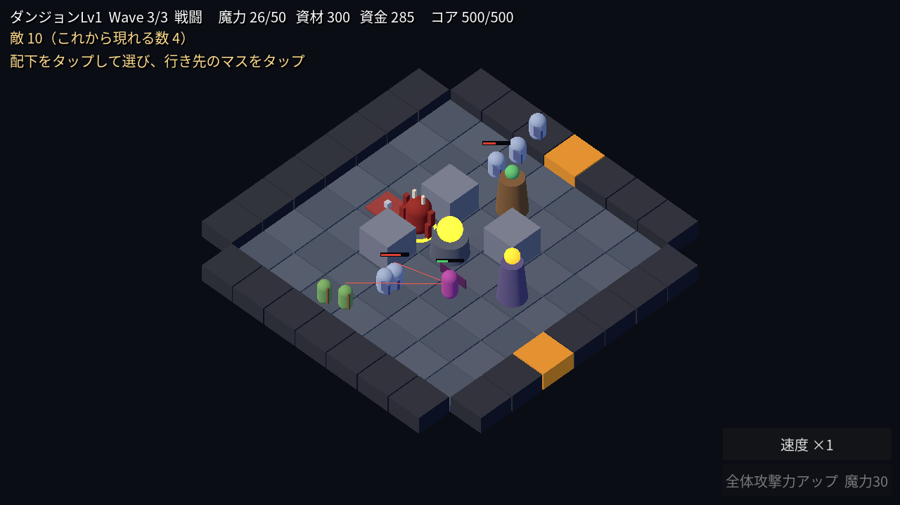

# Godot 試作：wave 構造（ダンジョンLv1）

作成日：2026-11-17。[全体設計](../docs/OVERALL_DESIGN.md)の骨格を、Godot 4.7系で遊べる形にした最小の試作。人間の国の兵士と弓兵が攻めてくる wave を3つ用意している。

**検証する問い：** 方向の分からない侵入に対して、施設で薄く備え、配下と全体魔法で厚くする判断が面白いか。



見た目は箱・円柱・カプセルを組み合わせた仮の立体で、KayKitなどのアセットは未導入。画像はLinux上のソフトウェア描画で撮ったもの。

## 開き方

1. Godot 4.7.2 を起動する。
2. プロジェクトマネージャーで「インポート」を選び、この `game` フォルダの `project.godot` を指定する。
3. 開いたら F5（または右上の再生ボタン）で実行する。

## 遊び方

**準備**

| 操作 | 内容 |
| --- | --- |
| 左下のボタン | 置くものを選び、盤面のマスをタップする。防壁・弓塔・魔法塔・罠、撤去、採掘先の指定 |
| 「配下を動かす」 | 配下をタップして選び、持ち場にするマスをタップする |
| 「研究・雇用」 | 配下の雇用（資金）、魔法研究（魔力と資金）、武器研究（資金と資材） |
| ◀ ▶ | 挑戦する wave を選ぶ。クリア済みの wave は報酬が減る |
| 「襲撃を迎え撃つ」 | wave を始める。画面上部に敵の編成と方向の数が出る。出現位置は出ない |

**戦闘**

| 操作 | 内容 |
| --- | --- |
| 配下をタップ → マスをタップ | 配下をそのマスへ移動させる。着いた先で近くの敵と自動で戦う |
| 「全体攻撃力アップ」 | 魔力を使い、数秒間、配下と塔の攻撃力を上げる |
| 「速度」 | 1倍と2倍を切り替える |

戦闘中は設置・撤去・雇用ができない。敵が全滅すると wave が終わり、ダンジョンコアが残っていれば勝利。

**共通**：ドラッグで視点の移動、マウスホイールまたは2本指のピンチで拡大縮小。

## 実装した内容

- 7×7の盤面と中央のダンジョンコア。周辺の岩盤を採掘先に指定すると、wave 終了時に盤面が広がり資材を得る。
- wave 3つ。クリアで次を解禁。再挑戦は報酬が減額。
- 敵は盤面の外周から現れる。方向は挑戦のたびに抽選する。
- 防壁と塔は通行を塞ぐ。敵は迂回と破壊の安い方を選び、完全に塞がれていれば壊して進む。
- 魔力は戦闘中に湧き、残量を次へ持ち越す。
- 配下（デーモン、サキュバス）の雇用と、戦闘中の移動指示。
- 設備の撤去は全額返還。壊れた設備と倒れた配下は wave 終了後に復帰。

## 仮に決めて実装したこと

全体設計で未決の部分は、動かすために仮の内容を入れている。確定仕様ではない。

| 項目 | 仮の内容 |
| --- | --- |
| 数値全般 | すべて仮。[core/balance.gd](core/balance.gd) にまとめてある |
| サキュバスの幻惑魔法 | 当てた敵の移動を遅くする |
| 全体攻撃力アップの対象 | 配下と塔の両方 |
| 採掘先の指定 | 盤面に接する岩盤をタップ。1 wave に2マスまで |
| Lv1で広げられる範囲 | 11×11まで |
| 塔の通行 | 防壁と同じく通行を塞ぐ |
| 敵の狙い | 近くの配下を優先。弓兵は射程内の塔とコアを撃つ。それ以外はコアへ進む |
| 配下の最初の持ち場 | コアの手前側の2マス |
| 研究と雇用の画面 | 一つのパネルにまとめた。完成版では研究画面と武器防具画面に分ける |
| 採掘所 | 未表示。コボルドの出入りも未実装 |

## 未実装

アセットの導入、効果音と音楽、保存、ダンジョンLv2、施設の強化、配下の装備、Androidへの書き出し設定。

## 数値の調整

[core/balance.gd](core/balance.gd) を書き換えて実行し直す。距離の単位はマス、時間の単位は秒。wave の編成もこのファイルにある。

## 確認した内容と、していない内容

**確認済み（2026-11-17、Godot 4.7.2 のLinux版）**

- ルールの自動テスト80項目が通る。画面を使わずに実行できる。

  ```sh
  godot --headless --path game -s res://tests/run_tests.gd
  ```

- 仮想ディスプレイ上で実行し、準備・戦闘・研究雇用・結果の4画面が描画されること。1280×720 と 2400×1080 の2通り。
- 画面上の点とマスの対応が、エンジン自身の計算と一致すること。タップによる配下の移動指示が通ること。
- 単純な自動操作で40通り試し、wave 1 は初回で全勝、wave 2 は平均2回強で突破、wave 3 は8回の挑戦以内に6割が突破。難度の目安であり、調整の根拠にはしない。

**未確認**

- Windows 上の Godot エディタでの実行。
- 実際のマウス操作とタッチ操作の感触、ボタンの大きさ。
- Android 実機での動作と性能。
- 日本語の表示。システムのフォントを使う設定で、Windows と Android の実機表示は見ていない。

## 構成

| ファイル | 役割 |
| --- | --- |
| `core/balance.gd` | 数値と wave の定義 |
| `core/game.gd` | 状態とルール。描画に依存しない |
| `view/main.gd` | 表示と操作 |
| `tests/run_tests.gd` | ルールの自動テスト |
